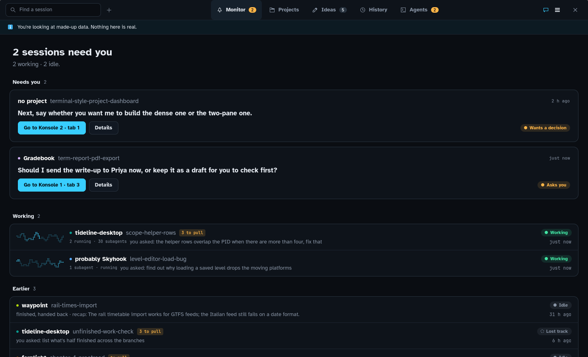
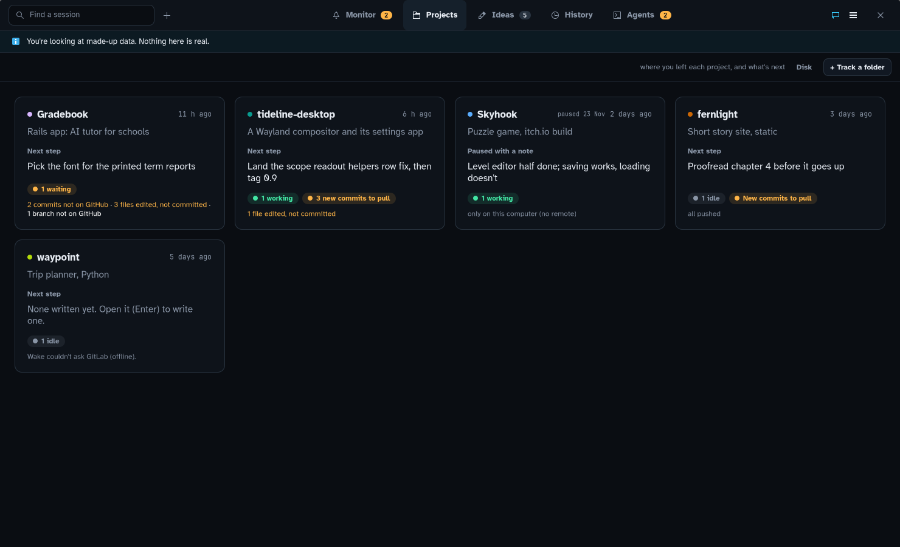
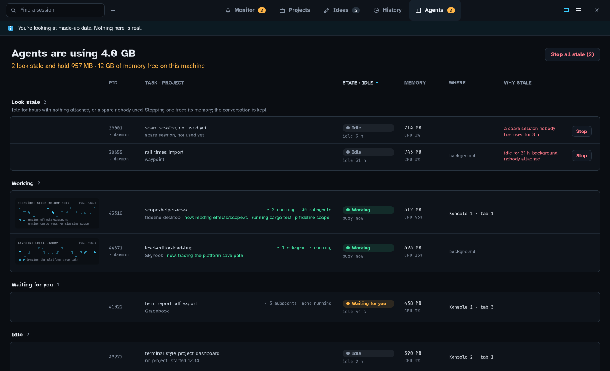

<div align="center">


# Wake

### Every coding agent you have running, and every project you left, on one board.

For people who keep several Claude Code or Codex sessions going at once, in Konsole tabs and in
the background, on a Linux desktop.<br>
It only reads. Nothing it learns about your sessions leaves your computer.

[**What it does**](#what-it-does) ·
[**Keys**](#keys) ·
[**What it reads and writes**](#what-it-reads-and-writes) ·
[**Getting it**](#getting-it) ·
[**With Slipstream**](#with-slipstream)



</div>

## What it does

You start an agent on something, then another, then switch projects, and an hour later you don't
know which tab is which, which one is waiting on you, or where you'd got to in the project you put
down yesterday. Wake reads what the agents already leave on disk and puts it in one window.

- **Monitor** starts with what needs you: each session waiting on a question or a decision is a
  card with the question in full and the way there under it. Then the sessions at work, each with
  its live trace and what you last asked, and everything else on one quiet line each.
- **Projects** shows where you left each project, a card each: the next step you wrote down (or
  Claude's last recap), the sessions open in it, commits waiting to be pulled, and git loose ends
  in plain words (uncommitted files, branches and commits not pushed, repos with no remote).
- **Ideas** keeps what you noticed while working (`c`, the `+` button, or `wake , text` in a
  terminal), as notes to sort into projects. Tick a few and start an agent on them with a brief.
- **History** lists every session by the day you last used it, and searches everything you asked,
  every session title and every file touched, including sessions Claude has since deleted: Wake
  keeps a summary of each.
- **Agents** lists the agent processes themselves, grouped by what you might do about them: the
  ones that look stale first (idle for hours with nobody attached, a spare nobody used), then
  those working, waiting for you and idle. Each says which PID is which task, how much memory it
  holds and how long it has been idle; a working one carries its readout. Claude's own background
  processes are folded away until you ask for them. You can stop an agent from here; Wake names
  the task and asks first.
- **Ask** (the speech bubble) asks your own `claude`, `codex` or `gemini` a quick question
  without opening a terminal, in threads you can come back to. They may only search and read;
  nothing that changes files is allowed.
- **Peek**: hold `Space` on a session to see it without leaving Wake, and let go to come back.
  On Slipstream the desktop slides to the agent's window; on KDE Plasma a small KWin script
  switches to it; anywhere else, and for background sessions, Wake shows the agent's terminal text.
- **Go there** (`o`) takes you to the session: its Konsole tab, a new window attached to a
  background session (`claude attach`), or a new window resuming an ended one.
- **Behind**: Wake asks each project's remote, now and then, whether someone pushed commits you
  haven't pulled, and says so before you start work on an old copy. It asks with
  `git ls-remote` and never fetches.
- **Disk** says what takes the space, by project and for the rest of the machine, in plain words:
  build output and caches that come back by themselves, agent worktrees that are merged, and what
  to leave alone.

The details (`Enter`, or a double click) open a session or a project in full: the question it is
asking and the way there first, then the prompts you sent, Claude's recap, files changed, and
subagents and what each handed back, each on a page of its own. They sit beside the list in a wide
window, slide over it in a narrower one, and take its place in a narrow one, with Back in the title
bar.

<div align="center">

</div>

<div align="center">

</div>

## Keys

| Key | |
|---|---|
| `1` to `6` | Monitor, Agents, Projects, Ideas, History, Ask |
| `g` or `Ctrl+K` | find a session by name; `→` looks inside at its subagents |
| `Enter` | the details; `Esc` goes back a page, then closes them |
| hold `Space` | peek at the session; let go to come back, `Enter` to stay |
| `o` | go there |
| `c` | capture an idea |
| `p` | pause the project, with a note for next time |
| `a` | ask a question |
| `/` | search everything you asked |
| `s` / `Shift+S` | in Agents: stop the selected agent / every stale one |
| `,` | settings |
| `?` | every key |

From a terminal:

```sh
wake              # open the window (also "Wake" in the app launcher)
wake find         # bring Wake forward with Find open: bind it to a key in your desktop's shortcuts
wake , idea       # keep an idea; the project comes from the folder you're in
wake ps           # agent processes: which PID is which task, memory, which look stale
wake disk         # what takes disk space, in plain words
wake behind       # projects behind their remote
wake doctor       # what Wake can see on this computer
```

## What it reads and writes

Wake is a reader. It reads `~/.claude` (transcripts, subagents, live sessions, background jobs),
Codex's sessions, `/proc`, Konsole's tabs over D-Bus, and your git repositories. Git is only ever
read, without taking locks, so it never gets in the way of an agent working in the same repository.
It never reads `*.key`, `.env` or credential files, never types into a terminal and never answers
an agent.

It writes its own files in `~/.local/share/wake/` (projects, ideas, pause notes, and an index that
keeps each session's summary after Claude deletes the transcript at 30 days) and its settings in
`~/.config/wake/settings.toml`. It keeps a short log of what it did and what went wrong in
`~/.local/share/wake/wake.log` (and the older `wake.log.1`), about 512 KB at most.

Everything else it does is something you ask for, and it asks again first:

- **Stop**, **End** and **Force** an agent process: `claude stop` for a background session, else
  the polite signal, and the forceful one only if it is still alive five seconds later. Wake
  refuses anything that isn't one of your agent processes, Claude's daemon, or itself.
- **Pull** a project that is behind: `git pull --ff-only`, only on a clean tree.
- **Clear** build output or a cache: moved to the Trash, never deleted.
- **Remove** an agent's worktree whose branch is merged and whose tree is clean
  (`git worktree remove`, never `--force`).
- **Go there** and **Start an agent** open a new Konsole window.

## Getting it

Wake is in beta, and is built from source for now. It needs GTK 4.14 or newer and Pango 1.56 or newer: Fedora 43
and later, Debian 13 and Ubuntu 26.04 have them. It also needs Rust through
[rustup](https://rustup.rs), because `rust-toolchain.toml` pins the version and a distribution's
own Rust ignores that file.

```sh
# Fedora: sudo dnf install gcc gtk4-devel rustup, then rustup-init
# Debian, Ubuntu: sudo apt install build-essential libgtk-4-dev, then rustup from rustup.rs
# (open a new terminal after installing rustup, so cargo is on your PATH)
git clone https://github.com/peterwalker78/wake && cd wake
cargo build --release --locked
install -D target/release/wake ~/.local/bin/wake
install -Dm644 data/io.github.peterwalker78.Wake.desktop ~/.local/share/applications/io.github.peterwalker78.Wake.desktop
install -Dm644 data/io.github.peterwalker78.Wake.svg ~/.local/share/icons/hicolor/scalable/apps/io.github.peterwalker78.Wake.svg
```

Make sure `~/.local/bin` is on your `PATH`, or neither `wake` nor the app launcher entry will
find it.

**First run.**

```sh
wake --demo       # the window on made-up data, as in the pictures above
wake doctor       # what Wake can see here, and what to install for anything missing
wake              # the real thing: it finds git folders under ~/Projects; track others from Projects
```

**Agents.** Claude Code is what Wake knows best: live state, background sessions, subagents,
recaps and questions it is waiting on. Codex sessions are read from their transcripts, without
live state. Gemini CLI processes appear in Agents, and Ask can use any of the three that
is installed.

**Desktops.** Go there and Start an agent use Konsole. Switching to a session's tab needs
`qdbus-qt6` (Fedora's `qt6-qttools`), or `qdbus6`, as Debian and Ubuntu name it in their
`qdbus-qt6` package. Peek on Slipstream and KWin, and
the notice when a project is behind, use `gdbus`. On Slipstream and KDE Plasma the desktop
brings the window forward; elsewhere Konsole switches tab and Wake says which window it is in.
The KWin scripts are written against KWin 6's scripting API and have not yet been tried on a
real Plasma session.

## With Slipstream

Wake works on any desktop, and goes further on
[Slipstream](https://github.com/peterwalker78/slipstream-desktop):

- **Peek and go there** use Slipstream's Look request: the desktop flies to the agent's
  workspace and rings its window, while the keyboard stays with Wake.
- **Monitor and Agents** draw each working agent's trace the way Slipstream's faded desktop does,
  from the notes [agent-notify](https://github.com/peterwalker78/agent-notify) leaves, in your
  Slipstream colours: in Agents, the whole readout, smaller.
- **A card for the plugin panel** (`plugin/`) shows how many sessions are waiting and working,
  with a button to the one waiting longest. Its README says how to install it.

## Building

```sh
cargo build
cargo test
cargo fmt --check && cargo clippy --all-targets -- -D warnings
```

Tests never touch the real desktop: every action has a dry run that returns the steps it would
take, and the tests use a fake `/proc`, fake D-Bus and scratch folders. To look at the window
without opening it, run it on an offscreen Broadway display:

```sh
gtk4-broadwayd :9 &
GDK_BACKEND=broadway BROADWAY_DISPLAY=:9 target/debug/wake --demo --view agents --screenshot out.png
kill %1
tests/wake-clips.sh      # checks nothing is cut off at any width, from 480 to 1600 pixels
```

AI coding tools are used in writing Wake's code. Every change is built and tested in CI.

## Licence

Free software under the GNU General Public License, version 3 or later. See
[`COPYING`](COPYING). The agent readout is ported from Slipstream, under the same licence.
